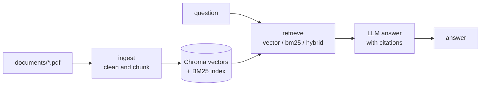

# Agent RAG Eval

A question-answering system over two PDF guides (an evaluation field guide and an agentic design patterns guide), plus a harness that measures how well it works. The point of the project is the **evaluation**: it separates retrieval failures from generation failures, so you know what to fix.

- **RAG pipeline:** PDF ingestion, local embeddings, vector, BM25 and hybrid retrieval, and answers with chunk citations. It abstains when the guides do not cover a question.
- **Three ways to evaluate it:** deterministic label-based metrics, in-house LLM judges, and DeepEval.
- **Golden set:** 54 questions with gold evidence (page and phrase), a dev/heldout split and unanswerable questions.
- **Observability:** every LLM call, including the judges, can be traced in Langfuse.
- **Providers:** OpenRouter or the NVIDIA API, switched with one variable.

> **Status:** the RAG pipeline and the evaluation harness work. The agent prompts in `src/prompts/defaults/` exist, but there is no agent module yet.

## How it works



- **Ingest** (`src/rag/ingest.py`): pypdf extracts the text, boilerplate is removed, and pages are split into chunks (900 characters, 150 overlap). Chunk ids look like `eval-guide:p6:c1` (document, page, chunk).
- **Retrieve** (`src/rag/retriever.py`): `vector` (Chroma with local `BAAI/bge-small-en-v1.5` embeddings), `bm25` (keyword), or `hybrid` (reciprocal rank fusion of both, the default).
- **Answer** (`src/rag/pipeline.py`): the LLM answers only from the retrieved chunks, cites them as `[chunk-id]`, and replies "The guides do not cover this." when the answer is missing.

## Setup

Requires [uv](https://docs.astral.sh/uv/) and Python 3.14 (uv installs it).

```powershell
uv sync
Copy-Item .env.example .env     # then fill in the keys
```

Minimum configuration in `.env`:

| Variable | Purpose |
|---|---|
| `LLM_PROVIDER` | `openrouter` (default) or `nvidia` |
| `OPENROUTER_API_KEY` or `NVIDIA_API_KEY` | key for the selected provider |
| `AGENT_MODEL` / `JUDGE_MODEL` (OpenRouter), `NVIDIA_AGENT_MODEL` / `NVIDIA_JUDGE_MODEL` (NVIDIA) | model names; the judge should come from a different family than the agent |
| `LANGFUSE_PUBLIC_KEY`, `LANGFUSE_SECRET_KEY` | optional; tracing is off without them |

The embeddings run locally and need no key. The first run downloads the embedding model (about 67 MB) and builds the index in `data/chroma`.

## Quick start

```powershell
# Retrieval only, no LLM key needed
uv run python scripts/try_retriever.py "what is pass^k?"

# Full pipeline: retrieve, then answer with citations
uv run python scripts/try_pipeline.py "What is pass^k and why does it matter?"
```

## Running the evaluations

| Command | What it does | LLM calls |
|---|---|---|
| `uv run python scripts/run_retrieval_eval.py` | label-based retrieval metrics for all three strategies | none |
| `uv run python scripts/run_rag_eval.py --limit 3` | pipeline answers scored by deterministic checks and 4 LLM judges | 1 pipeline + 4 judge per case |
| `uv run python scripts/run_rag_eval.py --no-judges` | same without the judges | 1 per case |
| `uv run python scripts/try_deepeval.py --suite rag --limit 1` | DeepEval metrics (`--suite retrieval` judges the context only) | about 20 or more per case |

Common options: `--split dev|heldout`, `--strategy vector|bm25|hybrid`, `--limit N`, `--no-save`. Reports are written to `reports/` as JSON and Markdown.

Tune on the `dev` split and run `heldout` once at the end, so you can tell real gains from overfitting.

## The three evaluation layers

| | Label-based (`evaluation/hard_coded_lib`) | In-house judges (`evaluation/judges`) | DeepEval (`evaluation/deep_eval`) |
|---|---|---|---|
| Measures | `recall@k`, `hit@k`, `mrr`, `ndcg@5`, `precision@5` | faithfulness, answer relevance, context relevance, correctness (1 to 5) | contextual relevancy, precision and recall, faithfulness, answer relevancy, correctness |
| Ground truth | gold page and phrase | reference answer | reference answer |
| Deterministic | yes | no | no |
| Cost | free | 4 calls per case | about 20 or more per case |

The label-based layer is the one to trust for retrieval. The LLM-based layers judge answer quality, but their scores depend on the judge model and need checking by hand.

## Results so far

Retrieval on the 49 answerable questions (k=10, measured 2026-10-25, hybrid is the default):

| strategy | recall@5 | recall@10 | mrr | ndcg@5 |
|---|---|---|---|---|
| vector | 0.898 | 0.949 | 0.754 | 0.758 |
| bm25 | 0.898 | 0.939 | 0.773 | 0.757 |
| hybrid | 0.888 | 0.939 | 0.798 | 0.778 |

The strategies are not clearly different: their confidence intervals overlap. Two questions fail on every strategy. See [analysis/retrieval-analysis.md](analysis/retrieval-analysis.md) for the per-case breakdown.

## Golden dataset

`datasets/data/v1/rag/rag_golden.jsonl` has 54 questions: 49 answerable and 5 unanswerable (the correct answer is to abstain). 44 are in `dev` and 10 in `heldout`. Each answerable question has evidence as `source`, `pages` and `phrases`, not chunk ids, so the labels still work after you change the chunking. `datasets/utils/loader.py` loads them and `manifest.yaml` detects silent changes.

## Project layout

```
documents/                PDF corpus
datasets/                 golden set (v1) and its loader and schema
src/
  rag/                    ingest, embeddings, bm25, retriever, pipeline
  llm/llm.py              chat model builder (OpenRouter or NVIDIA)
  prompts/                prompt registry; defaults/ and judge/ hold the prompt files
  observability/          Langfuse client and tracing helpers
  utils/config.py         settings from .env
evaluation/
  core/                   runner, statistics (bootstrap intervals, kappa), reports
  hard_coded_lib/         label-based metrics and the RAG suite
  judges/                 LLM judge, calibration and bias probes
  deep_eval/              DeepEval adapter, metrics and suites
scripts/                  commands to run the retriever, pipeline and evaluations
analysis/                 written analysis of the results
reports/                  generated evaluation reports
```

More detail: [evaluation/hard_coded_lib/doc.md](evaluation/hard_coded_lib/doc.md), [evaluation/deep_eval/rag_eval/doc.md](evaluation/deep_eval/rag_eval/doc.md) and [evaluation/deep_eval/rag_eval/metrics.md](evaluation/deep_eval/rag_eval/metrics.md).

## Notes and limits

- **Free tiers are slow and capped.** OpenRouter free models allow about 50 requests per day, and the NVIDIA trial endpoint can be slow. Use a small `--limit`, and prefer the label-based evaluation for retrieval.
- **Reasoning models can truncate the judge output.** The judge is built with reasoning off on OpenRouter. If a judge returns empty or non-JSON text, check which model it is.
- **Langfuse warnings.** Until the prompts are pushed to Langfuse, you will see "Prompt not found" warnings. The local prompt files are used instead.
- **Packaging is unfinished.** The `kb` and `kb-eval` entry points and the wheel packages in `pyproject.toml` point to modules that no longer exist, and there is no `tests/` folder. Run the scripts directly with `uv run python scripts/...`.