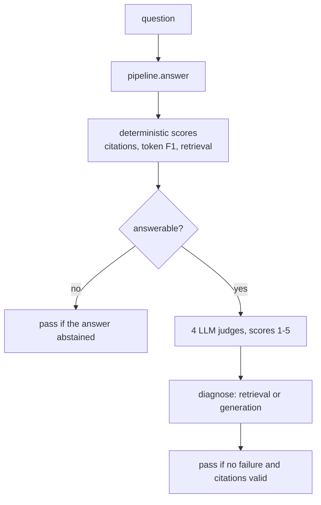

# Hand-written RAG answer evaluation

How `hard_coded_lib` scores a RAG **answer**, and how the LLM judges in `evaluation/judges/` work. The retrieval metrics are explained in `analysis/retrieval-analysis.md`. The DeepEval equivalent is in `evaluation/deep_eval/rag_eval/`.

**Status:** this code was copied in from an earlier package layout and its imports have not been updated (see section 8). It has not been run in this project.

## 1. Files

| File | Role |
|---|---|
| `suites/rag.py` | The RAG suite: runs the pipeline on the golden set, scores each answer, diagnoses failures. |
| `metrics/answer.py` | Deterministic answer metrics: abstention, token F1, citation checks, regex helpers. |
| `metrics/retrieval.py` | Retrieval metrics (`recall@k`, `mrr`, ...), reused by the suite. |
| `../judges/judge.py` | `LLMJudge`: scores one rubric from 1 to 5, with parsing, retry, disk cache, ensembles and pairwise comparison. |
| `../judges/__init__.py` | `make_judge(rubric)` and the list of rubrics. |
| `../judges/calibration.py` | Checks a judge against human labels and probes its biases. Not used by the RAG suite. |
| `src/prompts/defaults/judge_*.md` | The rubric prompts the judges send. |

## 2. What happens to one case

`evaluate_rag_case` does this for one case and returns a `CaseResult`. `run_rag_suite` runs it over the golden set (in threads) and aggregates with `summarize` like the other suites.

## 3. The scores

**No LLM needed**

| Key | Meaning |
|---|---|
| `has_citation` | 1.0 if the answer cites at least one chunk id |
| `citation_validity` | share of cited ids that were really retrieved (1.0 means no invented citations, and also when nothing is cited) |
| `token_f1` | word overlap with the reference answer. A coarse tripwire only: a correct answer worded differently scores low |
| `mrr`, `hit@1/3/5`, `recall@1/3/5`, `precision@5`, `ndcg@5` | retrieval metrics on the retrieved chunks (answerable questions only) |

**LLM judges** (answerable questions only). Each judge scores 1 to 5, and the report stores `(score - 1) / 4`, so 1 gives 0, 3 gives 0.5, 5 gives 1.0. The reasoning is kept in `details["<name>_reason"]`.

| Key | The judge compares | Needs |
|---|---|---|
| `faithfulness` | the answer with the retrieved context (a correct "the context does not say" scores 5) | context, answer |
| `answer_relevance` | the answer with the question | question, answer |
| `context_relevance` | the retrieved context with the question | question, context |
| `correctness` | the answer with the reference answer (if the reference says the info is unavailable, the answer must decline) | question, reference, answer |

## 4. Pass or fail, and the diagnosis

`diagnose(recall@5, faithfulness, correctness)` checks in this order, using the **raw 1-5 judge scores** for the last two:

| Order | Condition | Failure message |
|---|---|---|
| 1 | `recall@5 < 1.0` | retrieval: evidence missing from top-5 |
| 2 | `faithfulness < 4` | generation: answer not grounded in good context |
| 3 | `correctness < 4` | generation: grounded but incorrect or incomplete |

So a retrieval problem is reported first, because a bad answer is expected when the evidence was never retrieved.

**Answerable question with judges:** passes if `diagnose` finds nothing **and** `citation_validity == 1.0`.
**Answerable question without judges (`use_judges=False`):** passes if `recall@5 == 1.0` and `citation_validity == 1.0`.
**Unanswerable question:** passes only if the answer abstains (`abstained()`, a regex for phrasings like "the guides do not cover"). Only the no-LLM scores are recorded: no retrieval metrics and no judges.

`answer_relevance` and `context_relevance` are recorded in the report but **do not affect pass or fail**.

## 5. Abstention metrics

After the run, `_add_abstention_metrics` treats "should abstain" as the positive class. The label is `not answerable`, the prediction is `abstained(answer)`, and it adds `abstain_precision`, `abstain_recall` and `abstain_f1`. They are single numbers with no interval. They appear only if the run included an unanswerable case. Those are at the end of `rag_golden.jsonl`, so a small `limit` skips them.

## 6. How a judge works (`LLMJudge`)

1. **Prompt.** The rubric (for example `judge_faithfulness`) comes from the prompt registry and is filled with `{{variables}}`. It asks the model to list the claims, mark each, and then output a last line of JSON: `{"reasoning": "...", "score": 1-5}`.
2. **Call.** The reply is cached on disk (`data/cache/judge_cache.jsonl`), keyed by model name and prompt. A rerun on the same inputs makes no new call. This helps on a rate-limited free tier. Each call is traced in Langfuse when keys are set.
3. **Parse.** `parse_json_verdict` takes the last JSON object that has a `score` or `winner` key. It only matches objects with no nested braces. The score is rounded and must be between 1 and 5.
4. **Retry.** If nothing valid is found, it asks once more ("Return ONLY the JSON object"). After that it returns `Verdict(None, "unparseable judge output")`.

**Other tools in the same file**
- `aggregate(verdicts)`: the median of several judges, plus a flag when they disagree by 2 or more points.
- `score_pairwise` and `compare_pair`: pick the better of two answers. `compare_pair` judges both orderings and requires the same result, which controls position bias.
- `calibration.py`: `calibrate` measures agreement with human scores (exact, within 1 point, weighted kappa, Spearman, kappa on pass or fail, mean bias). `probe_position_bias` and `probe_verbosity_bias` test the two usual judge biases. These are for trusting the judge, and the RAG suite does not call them.

## 7. Cost compared with DeepEval

| | This lib | DeepEval suite |
|---|---|---|
| LLM calls per answerable case | **4** (one per judge), plus a retry if the output is unparseable | about 20 or more (several per metric) |
| Score scale | integer 1-5, so 5 values | fractions between 0 and 1 |
| Explanation | one short reasoning per judge | a reason per metric |
| Repeat runs | cached | not cached |

With the free-tier limit of 50 requests per day, 4 calls per case is what makes a full run possible. The prompts and scoring are less detailed than DeepEval's step-by-step verdicts.

## 8. Known problems

- **Imports do not match the current layout.** They still use the old package names: `assistant.config`, `assistant.llm`, `assistant.observability`, `assistant.prompts.registry`, `evals.*`, `datasets.loader` and `datasets.schema`. The current modules are `utils.config`, `llm.llm`, `observability.langfuse_client`, `prompts.registry`, `evaluation.*` and `datasets.utils.*`. In `suites/rag.py`, `core.*`, `judges` and `metrics.answer` also need the `evaluation.` prefixes.
- **`calibration.py` needs missing types.** `JudgeLabel` and `PairwiseProbe` are not defined in `datasets/utils/schema.py` any more, and there is no judge-label dataset.
- **A failed judge parse counts as a failure.** In `evaluate_rag_case`, `faith.score or 0` turns an unparseable verdict into 0, so `diagnose` reports a generation failure. Check the `*_reason` text for "unparseable judge output".
- **A bad reply can be cached.** The cache keeps whatever the model returned, including unparseable text.
- **`PASS_SCORE` (4) in `suites/rag.py` duplicates `PASS_THRESHOLD` in `judges/judge.py`.**
- **Abstention detection is a regex.** An abstention worded differently ("I could not find this") is marked as an answer.
